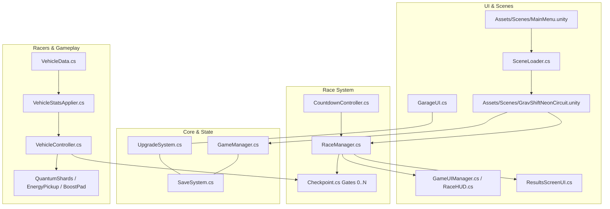

# ARCHITECTURE.md — NEON RUSH Architecture Specification

## 1. High-Level Architecture Overview
NEON RUSH: Grid Runners is built as an arcade anti-gravity racing game using a modular, decoupled architecture in Unity 6 LTS. The architecture balances high-performance arcade physics with deterministic state management, progression systems, and UI telemetry.

---

## 2. Core Subsystems & Responsibilities

### A. Core State & Lifecycle (`NeonRush.GameManager`)
- **Pattern:** Singleton with persistent state across scenes.
- **States:** `Splash`, `Title`, `MainMenu`, `Loading`, `Intro`, `Countdown`, `Racing`, `Paused`, `Finish`, `Results`.
- **Responsibilities:**
  - Manages active game state and fires `OnStateChanged` events.
  - Maintains session-level data: `selectedVehicleId`, `selectedTrackId`, `score`, `shardsCollected`, `raceTime`.
  - Interfaces with UI systems to show victory/game-over screens.

### B. Race Management & Lap Progression (`NeonRush.RaceManager`)
- **Responsibilities:**
  - Manages race countdown, active race timer, and completion state.
  - Registers all participating racers (`VehicleController` and `ShipController`).
  - Enforces ordered checkpoint sequences (`Index == nextCheckpointIndex`).
  - Detects finish line crossings to increment lap counts up to `totalLaps`.
  - Handles AI DNF timeouts (15s post-player finish and 180s total race timeout) to prevent deadlocks.
  - Triggers the results screen and awards credits.

### C. Vehicle Physics & Controls (`VehicleController` & `GameInput`)
- **Physics Model:** Custom arcade supercar suspension with raycast suspension cushions, aerodynamic downforce, upright stabilization torque, and drift mini-turbo charging.
- **Anti-Gravity System:** Hover height suspension (2.2m) with 3.5s activation window and collectible recharge cells.
- **Input System:** Integrated with `GameInput.cs` supporting both modern Input System actions and legacy directional mappings (W/A/S/D/Arrows/Space/Shift).

### D. Vehicle Customization & Progression (`VehicleStatsApplier` & `UpgradeSystem`)
- **Data Model:** ScriptableObject `VehicleData.cs` defining `VOLT`, `BRICK`, and `BLADE` presets (speed, acceleration, turn rate, armor, shape, colors).
- **Upgrade Multipliers:**
  - **Engine:** +15% Speed per level (Levels 1–3).
  - **Handling:** +10% Turn Speed per level.
  - **Boost:** +0.5s Anti-Gravity duration per level.
  - **Armor:** +20 HP per level.
- **Persistence:** `SaveSystem.cs` saves credit balance, unlocked vehicles, and upgrade arrays to JSON in `PlayerPrefs`.

### E. Scene Flow & User Experience (`SceneLoader` & UI Managers)
- **Scene 0 (`MainMenu.unity`):** Renders neon main menu banner with PLAY, GARAGE, and QUIT actions.
- **Scene 1 (`GravShiftNeonCircuit.unity`):** The primary gameplay race track with cyberpunk neon aesthetic, dynamic telemetry HUD, checkpoints, hazards, and goal triggers.
- **Safe Transitions:** `SceneLoader.cs` provides fallback fail-safes and avoids infinite loop reloads.

---

## 3. Team Ownership Boundaries
- **Member 1 (Vehicles & Combat):** Vehicle data models, vehicle controller physics, power-ups, upgrades, and handling.
- **Member 2 (Race Systems & AI):** RaceManager, checkpoints, countdown controller, camera follow, and AI opponents.
- **Member 3 (Core Systems & Integration):** GameManager state machine, save/load persistence, UI menus, audio manager, automated testing suite, and build pipeline.

